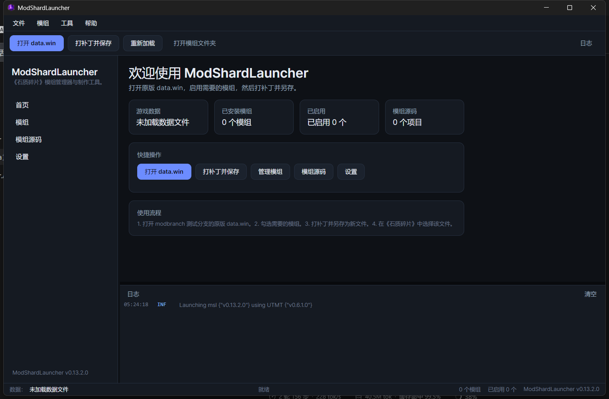

# ModShardLauncher（Avalonia 重构版）

《石质碎片》（Stoneshard）的**模组管理器**与**模组制作工具**。本仓库是从 WPF 版本重构而来的 .NET 10 项目，包含 **GUI（Avalonia）** 与 **CLI（无头）** 两个独立的可执行文件，共享同一个 Core 库。



## 功能

- 打开原版 `data.win`，扫描 `Mods/*.sml`，启用/禁用模组，打补丁并另存为新文件。
- 打开数据文件时，选择器默认定位到 Steam 安装目录 `C:\Program Files (x86)\Steam\steamapps\common\Stoneshard`；该目录不存在时回退到当前工作目录。
- 保存时默认建议 `<原文件名>_patched.win`，并禁止覆盖当前已加载的原版 `data.win`。
- 在 `ModSources/` 中编译 C# 模组工程为 `.sml`（运行时 Roslyn，保留原有流程）。
- 完整保留 `Msl` modding API（命名空间、类型、方法签名不变）；程序集版本固定为 `1.0.0.0`，旧 `.sml` 通过独立 `AssemblyLoadContext` 按简单名绑定宿主 API，无需重新编译。
- 现代 IDE 风格界面：顶部菜单 + 工具栏 + 左侧导航 + 底部固定高度日志面板（实时显示补丁过程，不可拖拽调整）+ 状态栏。
- 中 / 英 / 俄三语，采用标准 `.resx` + satellite assemblies；默认跟随 Windows 显示语言，没有对应翻译时回退英文，可在设置中固定语言。
- 设置中可选“导出清单”（默认关闭）：开启后每次打开 `data.win` 会生成物品、武器、护甲 CSV；CLI 的 `export` 命令始终可用。
- 独立 CLI：批量打补丁、列出模组、编译模组、导出数据，便于 CI 和服务器使用。

## 解决方案结构

| 项目 | 程序集名 | 输出 | 说明 |
|---|---|---|---|
| `src/ModShardLauncher.Core` | `ModShardLauncher` | 库 | Modding API + 补丁/加载/纹理/编译等全部领域逻辑，**无任何 UI 依赖** |
| `src/ModShardLauncher.GUI` | `ModShardLauncher.GUI` | `ModShardLauncher.GUI.exe` | Avalonia 桌面客户端（MVVM） |
| `src/ModShardLauncher.CLI` | `ModShardLauncher.CLI` | `ModShardLauncher.CLI.exe` | 无头命令行工具 |
| `tests/ModShardLauncher.Tests` | `ModShardLauncher.Tests` | 测试 | xUnit 单元测试（跨平台） |

> **重要**：Core 的程序集名必须是 `ModShardLauncher`。已发布的 `.sml` 内部程序集引用了这个程序集名，改名会让所有历史模组失效。

详细设计与兼容性约定见 [`docs/architecture.md`](docs/architecture.md)。

## 环境要求

- Windows 10 / 11 x64（游戏本身仅支持 Windows）
- .NET SDK 10.0.4xx（`global.json` 已固定主版本）

## 构建、运行与测试

```powershell
# 还原 + 构建整个解决方案（同时产出两个 exe）
dotnet build ModShardLauncher.Avalonia.slnx -c Release

# 运行桌面客户端
dotnet run --project src/ModShardLauncher.GUI

# 运行 CLI
dotnet run --project src/ModShardLauncher.CLI -- --version

# 运行单元测试
dotnet test tests/ModShardLauncher.Tests
```

> 便携模式：`Mods/`、`ModSources/`、`logs/`、`Settings.json` 都相对于**进程工作目录**。从发布目录启动 `ModShardLauncher.GUI.exe` 或 `ModShardLauncher.CLI.exe` 即可得到和旧版一致的便携布局。旧版 `Settings.json` 可直接复用。

## 发布（多文件 self-contained，两个 exe 同一目录）

```powershell
# 一条命令同时发布 GUI 与 CLI 到 publish/
.\scripts\publish.ps1
```

脚本等价于：

```powershell
dotnet publish src/ModShardLauncher.GUI/ModShardLauncher.GUI.csproj `
  -c Release -r win-x64 --self-contained true -o publish

dotnet publish src/ModShardLauncher.CLI/ModShardLauncher.CLI.csproj `
  -c Release -r win-x64 --self-contained true -o publish
```

发布目录会同时包含 `ModShardLauncher.GUI.exe` 与 `ModShardLauncher.CLI.exe`，共享同一份 Core/依赖。

发布目录需要保持**多文件**：

- 运行时 Roslyn 编译器需要从磁盘读取 `ModShardLauncher.dll` 的 `Location` 作为元数据引用；
- 运行时编译还依赖发布根目录下的 `netstandard.dll`、`System.Collections.dll`、`System.Runtime.dll`、`System.Linq.dll`、`System.ObjectModel.dll`（由 Core 的 `ModReference` 复制）。
- 因此请勿使用 `PublishSingleFile` / `PublishTrimmed`。

## 安装包（NSIS）

前置：安装 [NSIS](https://nsis.sourceforge.io/) 3.x（`winget install NSIS.NSIS`）。

```powershell
# 自动执行 publish.ps1，再调用 makensis
.\scripts\build-installer.ps1
```

- 产物：`artifacts\ModShardLauncher-Setup-<version>.exe`（当前约 38 MB，LZMA 固实压缩）；
- 默认安装到 `%LOCALAPPDATA%\Programs\ModShardLauncher`：按用户安装、无需管理员，安装目录可写，保持便携语义；
- 安装/卸载界面支持中文、英文、俄文；
- 安装前读取注册表检测旧版本，调用旧 `uninstall.exe /S` 并等待完成；
- 静默安装：`ModShardLauncher-Setup-x.y.z.exe /S /D=C:\path`（`/D` 必须是最后一个参数）；
- 静默卸载：`uninstall.exe /S`，默认保留 `Mods`、`ModSources`、`logs`、`Settings.json`；交互式卸载会询问是否保留；
- 卸载会结束 GUI/CLI 进程，删除程序文件、注册表项、开始菜单/桌面快捷方式，并清理可能存在的服务与防火墙规则。
## CLI

```text
ModShardLauncher.CLI.exe patch   --data <vanilla.win> --output <patched.win>
                                 [--mods <dir>] [--enable name1,name2 | --all]
ModShardLauncher.CLI.exe list    [--mods <dir>]
ModShardLauncher.CLI.exe compile --source <project-dir> [--mods <dir>]
ModShardLauncher.CLI.exe export  --data <vanilla.win> --type items|codes|presets

全局选项：
  --workdir <dir>   覆盖便携工作目录（默认当前目录）
  -h, --help        帮助
  -v, --version     版本
```

示例：

```powershell
# 打补丁：启用全部模组
ModShardLauncher.CLI.exe patch --data D:\Games\Stoneshard\data.win `
  --output .\modded.win --all

# 只启用指定模组
ModShardLauncher.CLI.exe patch --data .\data.win --output .\out.win --enable Quicksave,SpeedManager

# 编译 ModSources 下的工程
ModShardLauncher.CLI.exe compile --source .\ModSources\MyMod
```

退出码：`0` 成功，`1` 参数错误，`2` 编译/补丁失败，`3` 未处理异常。

## 目录与设置

```
<工作目录>/
├─ data.win              # 任意位置的原版数据文件
├─ Settings.json         # Language / LanguageChosen / EnableLogger / ExportManifests / EnabledMods
├─ Mods/                 # *.sml 模组包
├─ ModSources/           # C# 模组工程（含 .csproj 的子目录）
└─ logs/                 # 文件日志（Serilog），GUI 底部日志面板同步显示
```

## 本地化

- 资源文件：`src/ModShardLauncher.GUI/Resources/Strings.resx`（英文，中立资源）、`Strings.zh-Hans.resx`、`Strings.ru.resx`。
- 使用标准 `ResourceManager` + 卫星程序集，没有自研格式。
- XAML 中通过 `{loc:Tr Key}` 绑定到可观察的 `LocalizedText`，切换语言后所有界面文本即时刷新。
- 新增语言：添加 `Strings.<culture>.resx`，并在 `SettingsViewModel.Languages` 中注册。

## 已知问题

分析报告 5.1 节列出的历史缺陷已全部处理并有回归测试（B1、B2、B4、B5、B6、B8、B9）；B3 在 Windows-only 目标下不适用。逐项状态见 [`docs/deferred-bugs.md`](docs/deferred-bugs.md)。

此外，`UndertaleModTool` 的二进制依赖仍按原样冻结；其 `Magick.NET` 传递依赖未随发布输出，若走到需要 ImageMagick 的代码路径可能失败，后续单独处理。

## 许可证

GPL-3.0，见 [LICENSE](LICENSE)。本项目是社区项目，与 Ink Stains Games 无关。
